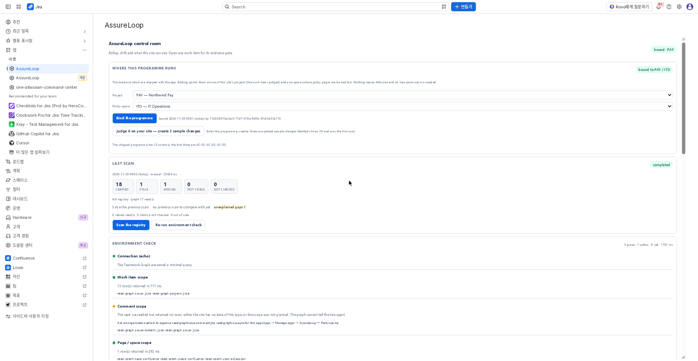

# AssureLoop for Jira

**Evidence, not spreadsheets.** Audit-ready answers from the Teamwork Graph, with the receipts.

**What it proves:** every claim a financial control requires, judged by fixed rules over the
Teamwork Graph and Atlassian REST, with the evidence object, its observation time, its freshness
window and the exact read that produced it, and a `not visible` / `not checked` answer when the app
could not look, instead of "no evidence".

**What it does not:** changes made outside this app (a verbal approval, an edit in another system),
evidence types with no connector on the site, and whether a recorded exception is substantively
right. Those are stated on every surface, not discovered by a reviewer.

**Measured 2026-11-20 (v6.48.0, demo site; the source in this repository is v6.50, see §2):** 20 claims across 12 controls, 18 verified, 1 stale, 1 missing, 0 not visible, 0 not checked in 22,989 ms, `graph 17 read(s)`; audit-pack fingerprint
`d851a46a6c4af955`-class value over 20 rows and 18 hashed fields, `Verify fingerprint -> VERIFIED MATCH`.
(The displayed digest is now 128 bits, so the value printed on a new pack is 32 hex characters long. The 2026-11-20 pack printed 16.)

### How it scores against the judging rubric

| Criterion | The evidence, in one line |
|---|---|
| **Technological Implementation** | 9 idempotent tables, 22 resolver keys, **625 assertions** (`npm run smoke`, no site needed), a Jira permission check as the first line of every write, a 6-second cap on every graph hop, retry isolation per call chain, and one deterministic verdict function shared by three surfaces |
| **Design** | Five states that are the product logic (`VERIFIED / STALE / MISSING / NOT_VISIBLE / INCOMPLETE`), the four surfaces (issue panel, Control Room, Confluence macro, Rovo agent) share one visual language, empty and error states are designed (nothing to judge yet / cannot see this / not checked), and an empty site reaches a judged one in one click |
| **Potential Impact** | 12 controls × 2-3 h of manual work per quarter is the **estimate** it replaces; what is measured is the read: 20 claims in 23 s, 37 pages no control claims found by the reverse scan |
| **Innovation / Idea** | `MISSING` requires a read that finished and saw nothing; a claim over a population prints how much of it was read; a universal claim fails on one unqualified object; the app publishes what it does **not** guarantee; and the cross-product claim `approval_independence` has no REST answer: it queries the policy page's owner, that owner's team and the team membership from Teamwork Graph, and anchors those hops in the evidence trace with the observation time of each. Where that read does not come back, the claim says `not visible` instead of inventing a finding |
| **Best apps with Teamwork Graph integration** | 4 curated hop families + 1 persisted Cypher traversal + a scope ledger that records which scopes the run actually proved, and a scope-named `NOT_VISIBLE` when it could not |

### Where to look without installing anything

Everything below runs in a browser tab or a terminal, with no Atlassian site, no account and no build step.

| What to check | Where | Time |
|---|---|---|
| The product itself: the Control Room's 20 claims, an Evidence panel with **Why?**, the audit pack, the trust boundary | `docs/demo/index.html` (open the file) or <https://luke-shin-ai.github.io/assureloop-for-jira/demo/>. Static HTML, no server, no build | 2 min |
| The numbers in this README against the code that produces them | `npm run check:claims` | 30 s |
| Every claim the engine rests on | `npm run smoke`: 625 assertions in 13 files, no site | 60 s |
| The 4:24 demo, narrated | <https://youtu.be/h7eMQPS6ioI> (public) | 4 min |
| The eight screenshots the submission uses | `docs/screenshots/` | 3 min |
| The audit pack rendered by a real Confluence macro | the demo site, page `ITO/AC-01 audit pack` | 1 min |

The static demo is a **recorded run**, not a live one: it renders the 2026-11-20 measurement of the
demo site, generated from the same rule data the app ships (`src/seed/northwind-pay.ts`), so a claim
you see there is the claim the engine judges and the states are the ones that scan produced. It is
also the one place a visitor can add a custom control and paste a JSON list without a site: the form
validates exactly what the Control Room's form validates, keeps the rows in the tab, and claims no
verdict for them, because a page with no Jira site behind it has nothing to judge.



---

## 1. What this is

A Forge app that answers an auditor's question (*"prove that this control actually
operated this quarter"*) by traversing the Teamwork Graph, returning evidence with
freshness **and provenance**, and closing the gaps it finds as Jira issues.

The product idea in one line: **configuration checkers ask whether a control is set up
correctly; AssureLoop asks whether it actually ran, and is honest about what it cannot see.**

### Five states

| State | Meaning |
|---|---|
| `VERIFIED` | Evidence exists, is fresh, and its owner is active where the app can read that |
| `STALE` | Evidence exists but is past the control's window, or its owner is deactivated where the app can read that |
| `MISSING` | Evidence really is absent, and the scan could see the data it looked at |
| `NOT_VISIBLE` | The app could not see the data (a Teamwork Graph scope was not granted) |
| `INCOMPLETE` | The scan could not check it this time (throttle, timeout, index lag, `teamsV2` 403) |

`NOT_VISIBLE` and `INCOMPLETE` are why the app exists. In a regulated institution,
"we could not see it", "we could not check it", and "it is not there" are three
different findings, and only the last one is the auditee's problem.

### Owner status: what is read and what is not

An owner's active flag is read where a surface supplies it: Jira REST returns
`assignee.active` for a work item, and the comment's author object carries the same field.
It is **not** readable for a Confluence page owner with this app's scopes: the graph's
`AtlassianUser` selection has no active flag and the app does not request `read:jira-user`.
A policy page whose owner has left therefore cannot be caught by the active flag, and the
panel says exactly that next to the row instead of promising a detection the code cannot
make. Reaching that case needs one more scope, which is a post-submission change.

### Population claims: how much was read, and how much qualified

A claim such as "every production change carries an independent approval" is a statement
about a set of objects. Every verdict over a population now reports both numbers:
`Verified: 11 of 12 independent approval object(s) qualify, freshest 2 day(s) old`.
Two rules govern the read:

- **Coverage is reported, never implied.** The JQL read follows the endpoint's page token up
to 200 changes; the approval read covers 25 changes per scan and says `25 of 61` when that
cap is what stopped it; a comment list is paged to 500. A cap that applies is printed in the
verdict, not hidden.
- **`everyItem: true` makes a claim universal.** With that flag the claim passes only when
every object that was read qualified *and* the whole population was read; a partial read is
`INCOMPLETE`, and one unqualified object is `MISSING` with `1 of 12 read qualified` in the
reason. Seven of the shipped claims carry the flag: AC-01 on the work item and on the
approval, AC-02, AC-04, AC-06, AC-07 and AC-10, which are the ones whose text says "each" or
"every". The other thirteen read existentially ("a record exists", "the policy is current")
and their text says so. The counts quoted at the top of this page were measured on 2026-11-20
with v6.48.0, before the flag reached the shipped programme; it can only fail a claim the
existential reading passed, so a rescan with the source in this repository can report more
`MISSING` or `INCOMPLETE` and cannot report less than the 2026-11-20 scan did.

### Approval language

An approval has to be stated, not mentioned. `statesApproval` reads the clause before and
after the approval word: a request (`seeking`, `requested`, `pending`, `awaiting`), a
withdrawal (`not`, `rejected`, `withdrawn`, `revoked`) and a state that has not happened
(`pending`, `deferred`, `none`, `not yet`, `on hold`, `subject to`, `not for prod`) all
stop a match, in either word order. `Approval from Legal pending`, `Approval: none`,
`Approval was sought`, `Tentatively approved` and `approved, but not for prod` are not
approvals; `Approved, and no further review is needed` and `No objections - approved` are.

`test/v640.regressions.cjs` pins that round: **17 rejections and 10 acceptances**.
`test/v650.regressions.cjs` adds **six shapes a red-team pass found on top of those**, and
they pull in opposite directions: a mention of the approval *process* (`Approval process:
see wiki page`), a review of the checklist that found gaps (`Reviewed the approval
checklist and found gaps`), a word the text itself withdraws (`un-approved draft`), and an
approval bounded to part of the change (`LGTM for the code only, not the release`) are all
refused; `I approve this change` and `I approved this change` are approvals, which the
shipped pattern could not match because it listed the noun and the past participle and not
the verb. The default is now `approve / approves / approved`, and a registry seeded by an
older build stores the old default: that exact string is recognised and widened when it is
read, while a pattern an administrator wrote is used as written. The 17 earlier rejections
are re-run against the widened pattern, so a wider verb cannot quietly re-admit a request.

### Who may write

Every write asks Jira first, as the person pressing the button:
`GET /rest/api/3/mypermissions?permissions=<name>&issueKey=<key>` read as the user. Three
answers, and they are not interchangeable:

| Answer | What the app does |
|---|---|
| granted | the write proceeds |
| denied | the write is refused, before any change, with the permission to ask for and who to ask |
| could not ask (a 4xx/5xx, a transport failure, an answer that does not state the permission) | the write is refused too: "I could not ask" is not "yes" |

`ADMINISTER` covers the programme (bind, seed, one-click onboarding, close gaps, record and
withdraw an exception, set the scan principal, add a custom control, import a list).
`EDIT_ISSUES` on the work item covers claiming it for a control and closing its gaps. A read
asks `BROWSE_PROJECTS` first: a confirmed denial returns `Not visible to you` with the
permission named and no verdict at all, while a check that could not be made is disclosed
and the read goes ahead, because the read itself is the authority on visibility and the
engine already reports a 403 as `NOT_VISIBLE` with the scope that fixes it. No new Forge
scope is used. A withdrawal also records who made it: the exception row keeps
`withdrawn_by` and `withdrawn_at`, so a gap that was carried and then let go has a name and
a date on it.

### Segregation of duties: both people on the item

The independent-approval claim keeps two pairs of hands apart, and a work item names two
people: the assignee who did the work and the reporter who raised it. An approval from
either is the work approving itself, and both are compared (the reporter was not read at
all before v6.50). The row says which one it was: `was approved by its own assignee` or
`was approved by the person who reported it`.

### Custom controls

The twelve shipped controls answer DORA and SOX change management; a team with a control of
its own adds it in the Control Room, as a small form (code, name, evidence type, freshness
window, `everyItem`) or as a JSON list, and the JSON import reports every row it refused
with the sentence for that row. A custom control is judged by the same engine and shows the
same row on the pack. The code, the Jira label and the window are validated, one claim per
evidence type is written (a second save updates it rather than adding a duplicate for the
scanner to judge twice), and the rule is stored in the same `rule_json` the shipped
programme uses, so nothing about the judgement is implied rather than written down.

### A project key is a whitelist

A project key is read into a JQL string (`project = "PAY"`), so it is the one input that can
change what a query means. It must match `^[A-Z][A-Z0-9_]+$`: a quote, a space, an `OR` or
anything else is refused with the reason and never escaped into the query. The same
validation runs on binding, on the one-click onboarding, on the demo seed and on a custom
control's project, and `test/v650.regressions.cjs` proves that an injected key produces no
JQL request at all.

## 2. Status

| Area | State |
|---|---|
| `manifest.yml` | **Valid**: `forge lint` -> *No issues found* (app registered) |
| Forge SQL schema + query helpers | Written (9 tables, idempotent DDL) |
| Teamwork Graph access layer (curated + persisted) | Written; persisted traversal enriches the trace when its `queryKey` is registered |
| Verdict engine (5 states, deterministic) | **Written and tested** (`npm run smoke`, 625 assertions) |
| Retry/backoff + failure classification | **Written** (3 attempts, exponential backoff, `Retry-After`) |
| Evidence Gate (issue panel) | **Written**: live judgement per work item, trace, gap closure |
| Provenance Trace (SVG) | **Written**: node/link per hop with ARI, relation, observed time |
| Environment Check (6 probes / 5 s) | **Written**: backend + both surfaces |
| Control Room (global page) | **Written**: rollup, drift, integrity, Environment Check |
| Confluence macro (audit pack) | **Written, verified live**: claim-level pack with evidence links, as-of scan time, SHA-256 fingerprint (displayed as 32 hex / 128 bits), one-click memo, `Verify fingerprint` (VERIFIED MATCH, recomputed over 20 rows) |
| Bind (empty site) | **Written**: one click binds the shipped programme to a project + space, no new scope; discovery mode judges recent completed changes when no control labels exist |
| Rovo agent + 4 actions | **Written**; GET actions are stateless (no Forge SQL dependency) |
| Scheduled drift scan | **Written, verified live (unattended)**: every graph hop reads as the stored scan principal with a 6 s cap and a circuit breaker; an unread hop falls back to the page's own owner fields (labelled `rest`) or INCOMPLETE. Measured 2026-11-20: scheduled scan 19,587 ms, 17 graph reads as the principal, 0 capped, the same verdicts as that day's manual scan |
| Reverse (orphan) scan | **Written, verified live**: Confluence REST + registry, so it finds pages in the programme's spaces that no control names (37 on the demo site) |
| Exceptions + unexplained gaps | **Written, verified live**: `claim_exceptions` (reason, expiry, compensating control); the pack counts what nobody has explained |
| Fingerprint re-verification | **Written, verified live**: `Verify fingerprint` recomputes the pack's SHA-256 and shows VERIFIED MATCH / DRIFT DETECTED |
| Trust boundary | **Written**: "what this pack guarantees / does NOT guarantee" on the panel, the Control Room, the macro and in the memo |
| Seed data (Northwind Pay) | **Written**; insertion needs a live site |
| `forge deploy` / install | **Source here is v6.50, which is not deployed yet.** What runs on `one-atlas-xkzp.atlassian.net` today is **development 6.48.0** and **production 2.1.0** (deployed 2026-11-20T09:04:34Z), Jira and Confluence both Up-to-date, Runs on Atlassian eligible on both. The distribution link (Sharing with anyone) installs **2.1.0**, so that is the build a reviewer sees; v6.49 added two post-submission fixes (the approval wording rule and the universal-claim flag described above); v6.50 adds the permission check on every write, the reporter half of segregation of duties, a validated project key, the six approval shapes of §1 and the custom-control form and import of §3. They go out in the first post-submission release, planned after 2026-12-13 |

## 3. Structure

```
assureloop/
├── manifest.yml                 # modules, scopes, resources (app.id set by forge register)
├── package.json                 # @forge/api, @forge/resolver, @forge/sql, @forge/bridge, esbuild
├── src/
│   ├── index.ts                 # resolvers, 4 Rovo actions, registry scan, scheduled trigger, seed
│   ├── engine/
│   │   ├── gate.ts              # E1/E2/E3/E4: judge one work item live, close its gaps
│   │   ├── input.ts             # project key / control code / label / window validation
│   │   └── envcheck.ts          # E5: six probes, one budget, GREEN/YELLOW/RED
│   ├── perm/guard.ts            # mypermissions as the user: the first line of every write
│   ├── registry/custom.ts       # custom controls: validation, one claim per save, JSON import
│   ├── trace/graph.ts           # provenance hops -> node/link graph for the SVG
│   ├── twg/queries.ts           # curated + persisted queries, retry/backoff, scope probes, 5-state judge
│   ├── jira/rest.ts             # JQL, issue, comments, components, remediation issues
│   ├── confluence/rest.ts       # page freshness, space resolution, page ARIs
│   ├── schema/sql.ts            # DDL (migrationRunner) + typed query helpers
│   ├── audit/pack.ts            # fingerprint (18 hashed fields), memo, re-verification
│   ├── audit/orphans.ts         # reverse scan: pages no control names
│   └── seed/northwind-pay.ts    # synthetic programme (12 controls, 7 pages, 12 changes)
├── ui/                          # Custom UI sources (bundled by scripts/build-ui.mjs)
│   ├── shared/{ui.js,styles.css}# bridge calls, DOM, trace renderer, env panel
│   ├── issue-panel/main.js      # the Evidence Gate
│   ├── control-room/main.js     # the rollup
│   └── macro/main.js            # the audit pack
├── static/{issue-panel,control-room,macro}/   # index.html + built main.js + styles.css
├── docs/demo/                   # static, no-install demo of the Control Room and the pack (GitHub Pages)
├── docs/index.html              # Pages root, sends a visitor to the demo
├── docs/screenshots/            # the eight screenshots the submission uses
├── scripts/                     # build-ui, build-demo, check-claims, check-demo (browser measurement)
├── skills/audit-pack-playbook/SKILL.md
├── resource/agent/{prompts,icons}/
└── test/                        # 13 files, 625 assertions, no site required
```

## 4. Prerequisites

- Node **22.23.4+** (or 24.x). The numbers in this document were measured on v22.23.5.
- Forge CLI **15.1.0** (`npm install -g @forge/cli`).
- An Atlassian account + API token with the Forge scope.

```bash
export FORGE_EMAIL="<Atlassian account email>"
export FORGE_API_TOKEN="<token>"
```

The app is already registered (`app.id` in `manifest.yml`). A **Developer Space**
named *AssureLoop* was created for the account during registration.

## 5. Local checks (no site needed)

```bash
npm install
npm run typecheck   # tsc --noEmit, strict
npm run smoke       # compiles, then 625 assertions across 13 test files (see TESTING.md §7)
npm run check:claims # docs, code and the measured numbers must agree
npm run build:demo  # regenerates docs/demo/data.js from the shipped programme
npm run test:demo   # Playwright: 1440, 1920 and 390x844, no horizontal scroll (needs python playwright)
npm run build:ui    # esbuild -> static/*/main.js (committed as well)
forge lint          # manifest + code: expects "No issues found"
```

`npm run check:claims` is the script that keeps this README honest. It reads the numbers out of
the code (controls and claims in `src/seed/northwind-pay.ts`, hashed fields in
`src/audit/pack.ts`, scopes and modules in `manifest.yml`, resolver keys in `src/index.ts`, tables
in `src/schema/sql.ts`, and the assertion counts by running each test file) and then fails if a
public document disagrees or still carries a measured value that has been superseded. It is the
documentation-to-code numeric consistency check: a plain Node script with no dependencies,
`node scripts/check-claims.mjs`, and no site or credential of any kind.

The smoke suite pins the claims the product rests on:

| Group | What it proves |
|---|---|
| Verdicts | fresh -> `VERIFIED`; old -> `STALE`; absent with a proven scope -> `MISSING`; unproven scope -> `NOT_VISIBLE` (never `MISSING`); denied read -> `NOT_VISIBLE` |
| E4 | throttled / unindexed / unread population / `teamsV2` 403 -> `INCOMPLETE`, never `MISSING`; a missing-scope failure -> `NOT_VISIBLE` |
| Classification | 429 -> rate limit, `teamsV2 403` -> service error, plain 403 -> permission, 504 -> timeout |
| E2 | the trace keeps every node, link, relation and observation time; hop depth becomes columns; **no two node boxes overlap, no relationship label is painted under a box or outside the drawing, and a backward hop gets a column of its own** |
| E5 | six probes, prescribed ids, inside the budget, every probe carries a remedy |
| Gate fixture | against a fake Atlassian: claims judge without a scan, a 412-day-old policy is `STALE` with a working URL, a denied ownership hop is `NOT_VISIBLE` naming the scope, a throttled comment read is `INCOMPLETE` with `RATE_LIMIT_EXCEEDED` |
| UI render | in jsdom: the trace draws one box per hop node and one curve per relationship, the footer shows `queryKey, rows, ms, retries`, the environment panel colours each probe and names the scope to approve |
| Control room | in jsdom: clicking **Scan the registry** really calls the `scanNow` resolver (regression test for the shadowed handler that made the button dead) |
| Resolver surface | every `resolver.define` key is defined once. A duplicate throws at runtime on the first call and takes down every surface |
| Robustness | with no site reachable the gate returns `NOT_EVALUATED` instead of throwing; the registry falls back to the shipped programme |

## 6. Runbook

### 6.1 Deploy and install

```bash
npm run build:ui          # bundles the three Custom UI surfaces, from the repository root
forge deploy
forge site provision      # demo site (90 days); provision in early December
forge install --demo-site
```

Installing with the Teamwork Graph scopes requires an **organisation admin** when the
person installing is not a site admin; with a site-admin account (the demo site) the scopes
are granted by `--confirm-scopes` and no separate consent screen appears.

**Live demo site (2026-11-18):** `https://one-atlas-xkzp.atlassian.net`, valid until
**2027-02-16**: it covers the judging window (2027-01-06 to 2027-02-04).

### 6.2 Demo content, then seed

| What | Requirement |
|---|---|
| Jira project | key **PAY** |
| Labels | `ctrl-ac-01` ... `ctrl-ac-12`, one per control |
| Work items | 12 changes; set some to Done, leave one in review, and have one approved by its own assignee (that is the `MISSING` case) |
| Confluence spaces | `CM`, `SEC`, `OPS`, `RISK`: map these to spaces that exist on the site (the demo site uses `ITO`, `SECOPS`, `LEGAL`; `seed/northwind-pay.ts` and each rule's `spaceKey` must agree) |
| Pages | `Change Management Policy v3` (CM), `Production Access Review Procedure` (SEC), `Backup and Restore Standard` (OPS), `Incident Management Runbook` (OPS), `Third-Party Risk Standard` (RISK), `Data Retention Policy` (RISK) |
| Page ages | the seeded pages are "today", so they can never age out on their own. `STALE` comes from **AC-06**, which is tied to the site's own `Incident Runbooks` page (ITO, last edited 2021-08-01, ~1,900 days against a 180-day window). Pointing one control at a genuinely old page is the only honest way to show it |

Then invoke `resolver: seedDemo` from a surface that can reach the app (a resolver call, not
a UI button: the shipped app has none). Seeding refuses to run if `PAY` has no work items,
because a registry of unresolved links would produce fake evidence. Re-seeding replaces a
control's links instead of stacking a second set, so a fresh copy of a page cannot outrank the
aged one.

**The control room and the macro do not share a database.** Forge SQL is scoped to the
installation that invokes the function, so the Jira app and the Confluence app each have their
own registry and scans. Seed and scan through the product whose surface you are demonstrating:
the audit-pack macro reads the Confluence side, the control room reads the Jira side.

### 6.3 Register the persisted Cypher queries (optional, enriches the trace)

```bash
curl -sS -X POST "https://<site>.atlassian.net/gateway/api/twg/cypher-queries" \
  -H "Content-Type: application/json" -H "Authorization: Bearer $ATLASSIAN_API_TOKEN" \
  -d '{ "appId": "ari:cloud:ecosystem::app/f671f494-1c70-40d1-a9e7-624b9d45ada2",
        "name": "assureloop.evidence-chain",
        "cypher": "MATCH (item:JiraWorkItem {ari: $issueAri})-[:content_entity_links_entity]->(page:ConfluencePage) ...",
        "paramsSchema": [{ "name": "issueAri", "type": "ARI", "required": true }] }'
# -> 201 { "queryKey": "..." }   (resubmitting identical Cypher is safe: 200, same key)

forge variables set ASSUR_QUERY_KEY_EVIDENCE_CHAIN <queryKey>
```

Without keys the app runs curated-only: the trace shows the REST/curated hops and the
Environment Check's *Persisted query* probe says so in yellow. Nothing throws.

### 6.4 First run

1. Open any `PAY` work item -> the **Evidence** panel already shows a verdict and rows.
   No scan button in the path.
2. Press **Why?** on a claim -> the trace draws issue -> comment -> approver -> policy page -> team, with each hop's ARI, relation and observation time, and `queryKey, rows, ms`
   underneath.
3. **Close the gaps** -> one Jira issue per missing/stale claim, with the owner route
   that produced the assignee (`graph_page_owner` -> `issue_assignee` -> `component_lead`).
4. Control Room (Apps -> AssureLoop) -> rollup, drift, scan integrity, Environment Check.

### 6.5 The NOT_VISIBLE demo (replaces "toggle a scope and rescan")

The old plan (revoke `read:graph:page:confluence` on stage and rescan) does not
reproduce: scope changes take about a minute to propagate and rows keep coming back
after removal. Instead, **install with one scope deliberately declined** ahead of
recording (or use a site where the admin withheld it). Then:

- policy claims render `NOT_VISIBLE, missing scope: read:graph:page:confluence`,
- every other claim still judges normally,
- the Environment Check's page probe is red and names the scope to approve.

Two more honest variants show the same state without touching scopes: a **policy page in a
space the app cannot read** (remove the space from the app's view, or bind the programme to a
space the app cannot see), and a **work item whose assignee is deactivated**: that is the one
deactivated-owner path the code can actually evidence, because `ownerActive` comes from the
Jira REST assignee. Confluence page ownership cannot show it: `confluencePageOwners` returns no
rows on this site (G0 #7), so the panel now prints **owner not resolved** next to such a page
instead of implying a live owner. The `control_owner` route in the fallback chain is also
documented as a last resort, not a promise: no seed resolver writes `owner_account_id`.

### 6.6 A site with none of the demo's data (Bind + Discovery)

The demo's `PAY` project and `ITO` space are not on a judge's site, so the shipped programme now
has a one-click home for them:

1. **Control Room -> "Bind the programme"**: pick a project (`read:jira-work`) and a space
   (`read:page:confluence`), press once. The twelve controls' `jira_project_key` and every policy
   rule's `spaceKey` are rewritten in Forge SQL, and the demo's evidence links are retired (a link
   to a page this site does not have is not evidence).
2. **Scan.** A project with no `ctrl-ac-*` labels is judged in **discovery mode**: the five most
   recently completed changes are used, and every row says so. A label-less site therefore shows
   a real verdict about its own work items instead of an empty table.
3. Anything still unjudgeable is reported as **"Programme not bound to this site"** with
   `UNCONFIGURED` as the cause, not `NOT_VISIBLE`. A missing project is a setup step, not a
   permission the admin withheld.

No scope was added for any of this. `seedDemo` is no longer PAY-only either: it takes the bound
project, then `PAY`, then the first readable project.

### 6.7 The audit pack (a workpaper, not a dashboard)

`Confluence macro -> AssureLoop audit pack` (and the Control Room's audit card) renders the last
scan as a claim-level table:

| Column | Source |
|---|---|
| Control / claim / state / reason | `findings` (deterministic engine) |
| Evidence + link | the finding's evidence ARI, linked as `/wiki/pages/...` or `/browse/<KEY>` |
| Observed | when the evidence object was last touched (page version, issue update) |
| Window | the requirement's `max_age_days` |
| Issue | the remediation issue raised for that finding |

The header is **as of** the scan's finish time, and the footer carries a **SHA-256 fingerprint**
over the claim rows (SHA-256 cut to 128 bits for display, Node `crypto`, nothing leaves Atlassian). Rebuilding the pack
from the same scan yields the same fingerprint, so a reviewer can check that the table they were
handed is the table the app produced. **Copy the audit memo** puts the deterministic text (one
line per claim, the as-of and the fingerprint) on the clipboard from the panel, the macro and
the Control Room; the same rows produce the same words, and the model never writes them.

Forge SQL is per product, so the Confluence installation keeps its own scan history: the macro's
**Scan now (this installation)** button fills it without needing a temporary resolver (G0 §9-4).

### 6.8 Exceptions, re-verification and the reverse scan (v6.26)

Three additions that answer the questions an auditor asks *after* reading the pack.

**Recording an exception.** Control Room -> *Unexplained gaps* -> **Record an exception**.
A reason and an expiry are mandatory; the compensating control is optional. An exception
never changes a verdict: the state stays what was measured. It turns an unexplained gap
into an explained one, disclosed on the pack with its author, expiry and compensating
control. Withdrawing it makes the gap unexplained again.

**Verify fingerprint.** The pack prints a SHA-256 over its claim rows. *Verify fingerprint*
rebuilds the pack from the same scan, re-hashes it with the same function, and shows
**VERIFIED MATCH** or **DRIFT DETECTED** with the recomputed value, both on the macro and in
the Control Room. Drift means the rows behind the paper changed (a different scan, a wiped
database, an edited row): re-issue the pack.

**Unclaimed evidence (reverse scan).** After every scan the app lists the pages of the
programme's spaces and subtracts every page a control names in its rules or carries as a
registered link. What is left is evidence nobody asserts, an obligation missing from the
programme, or a document nobody uses. It reads Confluence REST plus the registry and says so
on the card (`rest+registry`); it reports truncation instead of a clean zero.

**The trust boundary.** Every pack (panel, Control Room, macro, memo) prints what it
guarantees (deterministic observation inside the app's scope, hash equality, named blind
spots) and what it does not: changes made outside the app, systems with no connector, and
whether an exception is substantively right.

## 7. Environment variables

| Variable | Purpose | Set with |
|---|---|---|
| `ASSUR_QUERY_KEY_EVIDENCE_CHAIN` | `queryKey` of the persisted work-item -> policy -> space -> team traversal | `forge variables set -e <environment>` |

Absent keys are handled: the code falls back to curated queries, reports which route answered
(`trace.mode`), and records the persisted failure as a **note**: an optional enrichment never
moves a verdict. Note the scope of the setting: **Forge variables are per environment, not per
installation.** One `forge variables set -e development` applies to every site installed from
that environment, which is why the failure isolation above had to land first. The scan principal
lives in SQL (`app_config.scan_principal_account_id`) and is therefore per installation.

## 8. Design decisions worth knowing

- **The gate is the product.** One work item, its claims, judged on open. The rollup
  exists for drift and installation health, not as the front door.
- **REST enumerates, the graph relates.** JQL is the precise way to list the work items
  a control is tested against; the graph is the only way to prove work item -> policy
  page -> space -> team -> person.
- **A failed read is never a verdict.** `runGraphQL` retries throttles and timeouts with
  backoff (honouring `Retry-After`); when retries are exhausted the failure travels with
  the observation and the claim becomes `INCOMPLETE`. `MISSING` requires a read that
  finished and saw nothing.
- **`observation.scope` is nullable.** A successful JQL response proves the caller can
  see the project, so an empty result is genuinely `MISSING`. A successful but empty
  *graph* response proves nothing, so the verdict gates on the scope ledger.
- **Scope ledger.** A scope is `PROVEN` only when a query that reads it returned rows.
  Empty is `INCONCLUSIVE`: the API fails closed. That is what stops a permission gap
  from being reported as an audit finding.
- **Owner routing degrades visibly.** Graph page owner -> page owner -> issue assignee -> component lead -> control owner. The route that was used is written into the
  remediation issue and shown in the UI, because a `teamsV2` 403 is a fact about the
  site, not a reason to fail silently.
- **Rovo actions are stateless.** `get-evidence` and `explain-verdict` recompute from
  the graph and REST; they never require Forge SQL, because a home-chat invocation can
  land on an installation whose database is not reachable. The control programme ships
  with the app, so the gate works before the database is seeded.
- **`allowImpersonation: true`** is declared (map form) on the scopes the daily scan
  needs: a scheduled trigger has no user, and `asApp()` has no `requestTeamworkGraph`.
  `forge lint` accepts it.
- **No egress, no external LLM, no Forge LLM.** Verdicts are rules; language is Rovo.

## 9. Verification checklist

| # | Claim | Status |
|---|---|---|
| 1 | TypeScript compiles clean (strict) | **Verified**: `npx tsc --noEmit`, 0 errors |
| 2 | Five states are deterministic; unproven scope ≠ MISSING; throttle ≠ MISSING; an absent page is MISSING; an unread population is never MISSING; a universal claim fails on one unqualified object; a persisted failure never moves a verdict | **Verified**: `npm run smoke`, 625/625 |
| 3 | `manifest.yml` passes Forge validation, including `jira:globalPage` and map-form scopes with `allowImpersonation` | **Verified**: `forge lint` -> *No issues found* |
| 4 | The app is registered and `app.id` is in the manifest | **Verified**: `ari:cloud:ecosystem::app/f671f494-1c70-40d1-a9e7-624b9d45ada2` |
| 5 | Custom UI bundles build and every `resource:` path resolves | **Verified**: `npm run build:ui`, `forge lint` |
| 6 | `content_entity_links_entity` traverses JiraWorkItem -> ConfluencePage | **Not needed in practice**: the graph returns no comment rows and no page-owner rows on the live site, so the trace is carried by the registry + REST hops (measured 2026-11-18) |
| 7 | Curated `confluencePageOwners` / `atlassianTeamsBySpace` / `atlassianUserInTeams` return rows | **Mixed (measured)**: `atlassianUserInTeams` -> 20 real teams (no 403); `confluencePageOwners` -> 0 rows on 7 pages, so the REST owner fallback is mandatory, not optional; `atlassianTeamsBySpace` -> 0 rows |
| 8 | Confluence v2 REST works with `read:page:confluence` / `read:space:confluence` | **Verified**: page list, page by id, space by key; **the v2 pages endpoint filters by `space-id`, not `space-key`** (fixed). Confluence also withholds *all* content from the app's own identity (200 + empty list, never a 403) when the app is not Runs-on-Atlassian, so page reads now retry as the requesting user / scan principal before a page is called absent |
| 9 | `teamsV2` 403 behaviour and the fallback route | **Not reproduced**: `atlassianUserInTeams` answered 200; the fallback stays as a safety net |
| 10 | Persisted Cypher is enabled for the judging environment | **Verified live 2026-11-18 17:05 KST**: `ASSUR_QUERY_KEY_EVIDENCE_CHAIN=c372c8f4-40be-4acf-9281-2fbceb39a07a` set for the development environment; Environment Check probe 6 is **green** (`customQuery` 5 rows / 813 ms) and the panel trace footer shows the key |
| 11 | Forge SQL `sql` module + `storage:app` provision on install | **Verified**: registry seeded (12 controls / 20 requirements / 12 evidence links), scans persist per installation; the migration flag is confirmed with a cheap read because one instance can serve both products, and the two `ADD COLUMN` migrations are idempotent on a concurrent first request |
| 12 | Macro renders on a real Confluence page | **Verified**: `ITO/AC-01 audit pack` renders the claim-level pack (20 rows; the 2026-11-19 pack printed fingerprint `f5f894d9ce02dafd` at 16 hex, the current build prints 32 hex), and **Scan now (this installation)** produced a fresh Confluence-side scan (3c1e66de) with observed dates |
| 13 | Empty-site path (Bind + Discovery) | **Read path verified live**: `siteSetup` lists 26 projects and the site's spaces; the bind card renders. The write path is **not** exercised on the demo site (it would re-point the demo registry and there is no live way to restore per-rule spaces) |
| 14 | Audit pack is reproducible and copyable | **Verified live**: the previous round produced `1ed720dc080bcf63` / `f5f894d9ce02dafd` at the old 16-hex display length. 2026-11-19: Jira scan `e9d2df0e` -> `e1ed21327ccc723f`, Confluence scan `b1f6f1cb` -> `0f0e4954b29fcafb`; **Verify fingerprint** returned *VERIFIED MATCH* on both surfaces |
| 15 | A 403 phrased `status code is: 403` is NOT_VISIBLE and is not retried | **Verified**: `hardening`/`judge`/`gate.fixture` (C1) shows the classification order is fixed; the fixture shows NOT_VISIBLE with 0 retries and the scope named |
| 16 | A graph read carries the claim, not decoration: a policy page whose ownership hop returns no rows is not verified | **Verified**: a policy page whose ownership hop returns no rows is **STALE**, reason names `confluencePageOwners` (scan.honesty). On the demo site the hop returns an owner, so counts did not move |
| 17 | The scope ledger is a measurement | **Verified**: `scopeProbeFromObservation` in both gate and scan; the scan's probe matrix now receives space/page/Jira-space ARIs |
| 18 | PR/deployment/test-record claims are not the work item itself | **Verified**: remote links + the control's record population; no connector -> UNSUPPORTED (kept out of gaps) |
| 19 | Reverse scan finds unclaimed evidence | **Verified live**: 43 pages read in ITO/SECOPS/LEGAL, 6 claimed, 37 unclaimed (2026-11-19 14:37 KST) |
| 20 | Exceptions and "Unexplained gaps" | **Verified live**: AC-06 exception recorded (until 2027-01-31, compensating control), card shows *Unexplained gaps: 1 of 2*, pack row discloses it |

**Full G0 record:** twelve probes with their numbers, four defects found and fixed, and the
unknowns left open. That record is kept with the project's working notes rather than in this
repository; what these pages quote from it is either read back out of the code by
`npm run check:claims` or dated to the scan that measured it.

## 10. Cost

$0. Forge functions/storage inside the free tier, demo site free for 90 days, no
external API, no container, no LLM billing.

## 11. Next

- **Post-submission release, planned after 2026-12-13:** deploy v6.50 to production so the
  install link serves the build this repository describes. It carries the approval wording
  rule, the universal-claim flag, and the scope cleanup that has to wait for the judging
  window (the unused impersonation on `write:jira-work` and `read:confluence-content.all`,
  both of which force every installation to re-approve).
- ~~W1: deploy + install on the demo site, seed Northwind Pay, run the G0 probes~~ done
  2026-11-18.
- ~~STALE row, trace-SVG overlap/label clipping, Control Room scan button, macro render~~ done
  2026-11-18: `STALE` comes from AC-06's aged runbook, the trace lays hops out in their own
  columns with wrapped labels, the dead scan button was a shadowed handler (`const scan =
  rollup.lastScan`), and the macro renders with real findings.
- Done 2026-11-18 (evening): the Rovo **Home** entry point now returns
  `needsSiteContext: true` with a deep link instead of "could not read PAY-1" (there is no Jira
  product context in home chat), and the persisted `queryKey` is set for the development
  environment. Remember that it is per environment, not per installation.
- W1: move schema migration to an `avi:ecosystem:installed:app` consumer.
- W2: audit-pack snapshot to a Confluence page. **Loom and Assets are cut**: the schema has
  `LoomVideo`/`AssetsObject` but the account has no Loom data and Assets exposes only
  `objects(ids:)`, so neither can be a hop (G0 #12). Optional hop if G0 shows the
  objects exist.
